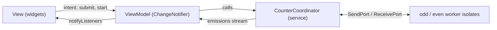
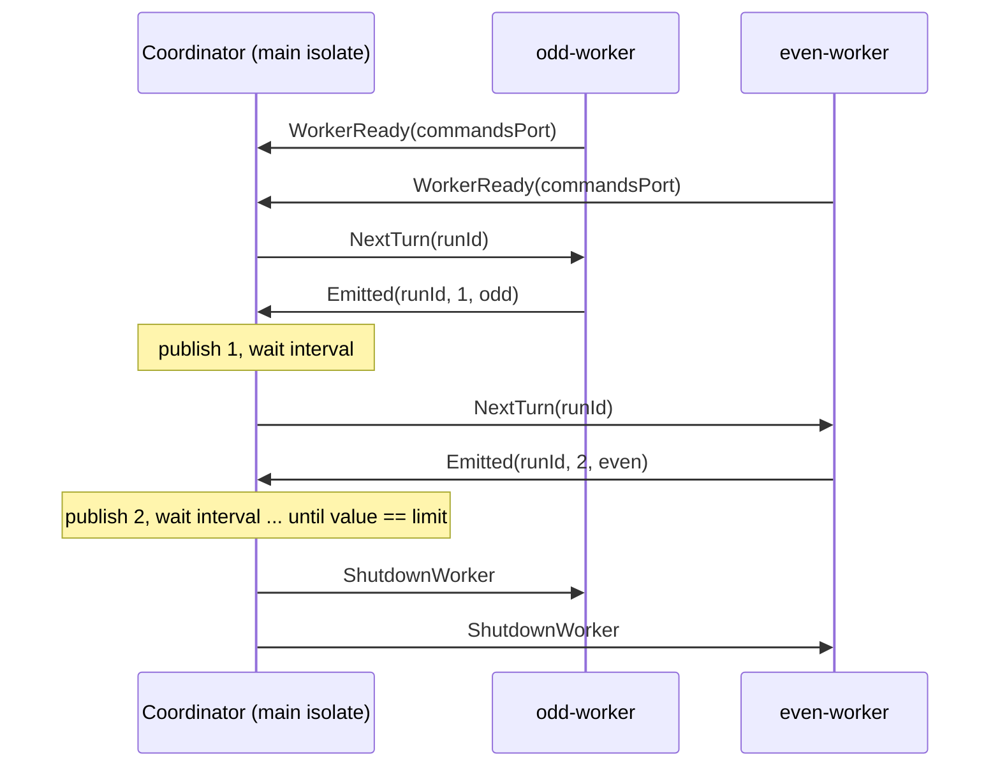

# Flutter Concurrency Challenge

A Flutter app (Android and iOS) with two tabs in a bottom navigation shell:

1. **Echo text**: a label, a text input and a button. Pressing the button
   (or Done on the keyboard) shows the trimmed input in the label.
2. **Isolate counter**: two long-lived worker isolates, one counting odd and
   one counting even numbers. They take turns so the label shows
   `1, 2, 3, 4…` in order, with start, pause/resume, stop, a speed slider and a
   limit N.

Specs: [`docs/specs/echo_text.md`](docs/specs/echo_text.md),
[`docs/specs/isolate_counter.md`](docs/specs/isolate_counter.md).

## Screenshots

> Placeholders. Captures will go in `docs/media/`.

| | Android | iOS |
|---|---|---|
| Light | `docs/media/android_light.png` | `docs/media/ios_light.png` |
| Dark | `docs/media/android_dark.png` | `docs/media/ios_dark.png` |
| Counter GIF | `docs/media/isolate_counter.gif` | |

Until then, the golden baselines in
[`test/goldens/baselines/`](test/goldens/baselines/) show every screen state in
light and dark, Android and iOS.

## How to run

| | |
|---|---|
| Flutter | 3.47.5 stable (Dart 3.13.4). Check with `flutter --version` |
| Platforms | Android, iOS (no web: `Isolate.spawn` is not available there) |

```bash
flutter pub get
flutter run
```

### Verify

```bash
dart format --set-exit-if-changed .             # 80 columns
flutter analyze --fatal-infos                   # must be clean
flutter test --exclude-tags golden              # unit, widget, coordinator (what CI runs)
flutter test --tags golden                      # golden tests
flutter test --tags golden --update-goldens     # regenerate baselines
flutter test integration_test                   # end to end, needs a device/emulator
```

Golden tests live in `test/goldens/*_golden_test.dart` and the baselines in
`test/goldens/baselines/`. Font rendering differs between operating systems, so
the baselines are generated on the author's machine and CI excludes the
`golden` tag.

## Architecture

MVVM as in the [official Flutter architecture guide](https://docs.flutter.dev/app-architecture),
with feature-first folders.



### Folder tree

```
lib/
├── main.dart
├── app/            # app.dart, router.dart, app_shell.dart, dependencies.dart
├── core/
│   ├── i18n/       # I18nKeys, delegate setup
│   ├── result/     # sealed Result<T> (Ok / Error)
│   ├── theme/      # AppTheme (fromSeed light/dark), tokens
│   └── widgets/    # adaptive/ (button, text field), MaxWidthBody
└── features/
    ├── echo_text/ui/                 # view_model/, widgets/
    └── isolate_counter/
        ├── domain/models/            # Parity, CounterEmission, CounterStatus
        ├── data/services/            # coordinator, worker, messages, exceptions
        └── ui/                       # view_model/, widgets/
```

Echo text is pure UI state, so it only has `ui/`.

### Choices

| Concern | Choice | Why |
|---|---|---|
| State | `provider` + `ChangeNotifier` | What the official guide uses; no code generation; ViewModels are plain Dart and easy to unit test. |
| DI | Constructor injection, `MultiProvider` at the root | The coordinator is an interface, so tests swap in a hand-written fake. ViewModels are created per route with `ChangeNotifierProvider`. |
| Navigation | `go_router`, `StatefulShellRoute.indexedStack` | Declarative routes, and each tab keeps its state when you switch tabs. |
| Adaptive UI | Material 3 on Android, Cupertino widgets on iOS | Branches on `Theme.of(context).platform` (not `dart:io`), so widget tests cover both via `TargetPlatformVariant`. Content is capped at 600 dp and must survive 2x text scale. |
| Theme | `ColorScheme.fromSeed`, light and dark | Follows the system; spacing, radius and sizes come from `core/theme/tokens.dart`. |
| i18n | `flutter_i18n`, `assets/i18n/en.json` and `pt.json` | Locale follows the device, English fallback. Keys are constants in `I18nKeys`, and a test checks both files have the same keys. |
| Errors | sealed `Result<T>` | Spawn failures come back as `Result.error`, handled with an exhaustive `switch`. |

## Multithreading

### Why isolates and not Futures

`Future`, `async`/`await` and `Timer` all run on **one** event loop, which is a
single thread. Isolates are Dart's real units of parallel execution. Each one
has its own memory and event loop, and they talk only through messages. Two
long-lived isolates created with `Isolate.spawn` are the faithful version of
"two threads". `compute` and `Isolate.run` are one-shot, so they are not used.
Each worker keeps its own counter, and the main isolate never computes the
numbers.

### Token passing

`IsolateCounterCoordinator` holds the turn token. Only one worker owns it at a
time, so the order comes from the design, not from timing.



Messages are sealed, immutable classes in `worker_messages.dart`
(`NextTurn`, `ShutdownWorker`, `WorkerReady`, `Emitted`), handled with
exhaustive `switch`.

### Correctness details

| Concern | How it is handled |
|---|---|
| Stale messages | `runId` goes up on every `start()` and `stop()`. Any `Emitted` with an old `runId` is dropped, so stop → start never shows a number from the old run. A spawn that finishes after a newer stop/start is shut down. |
| Pause / resume | `pause()` cancels the pending turn timer. `resume()` sends `NextTurn` to the worker that owns the next turn, unless a reply is still on its way (that reply reschedules itself). |
| Interval | The slider updates `interval`, which is read when the next turn is scheduled. A tick already waiting keeps its old delay, and the new pace starts after it. |
| Crash detection | Each worker is spawned with `debugName` (`odd-worker` / `even-worker`) and `onError`/`onExit` ports. A crash during a run ends it and sends a `CounterWorkerCrashed` error on the stream, so the ViewModel shows `failed`. |
| Fail fast at handshake | If a worker dies before sending `WorkerReady`, the spawn fails at once instead of waiting for the 5 s handshake timeout. `start()` returns `Result.error(CounterSpawnFailed)`. |
| Expected exits | Shutdown closes the ports before sending `ShutdownWorker` and calling `kill`, so a normal exit is never reported as a crash. |

### Lifecycle and cleanup

| Event | What happens |
|---|---|
| `start()` | Stops any previous run, then spawns two fresh workers for this run. |
| `stop()`, limit reached, crash | Cancels the timer, closes all ports, shuts down and kills both isolates. |
| ViewModel `dispose()` | Cancels the stream subscription and calls `coordinator.stop()`. |
| App teardown | The root `Provider<CounterCoordinator>` calls `dispose()`, which stops the run and closes the emissions stream. |

Because of `indexedStack`, switching tabs does **not** dispose the counter
ViewModel. A running count keeps going while the Echo tab is visible.

## Testing

| Kind | Where | What it covers |
|---|---|---|
| Unit (ViewModels) | `test/features/*/ui/view_model/` | State changes, notifications, validation, dispose. Uses `test/fakes/fake_counter_coordinator.dart`. |
| Coordinator | `test/features/isolate_counter/data/services/` | **Real isolates**, zero interval: exact `1..N`, alternating parity, pause/resume, restart from 1, rapid start/stop/start with no leaks, dispose. |
| Widget | `test/features/*/ui/widgets/`, `test/app/` | Android and iOS variants, pt locale, 2x text scale, tab state kept. |
| i18n | `test/core/i18n_files_test.dart` | en and pt have the same keys. |
| Golden | `test/goldens/` (tag `golden`) | Echo initial/filled, counter idle/running odd/running even/paused/finished, light/dark x Android/iOS. |
| Integration | `integration_test/app_test.dart` | Echoes text, then counts to 4 with the real coordinator. |

Test doubles are hand-written fakes. There are no mocking packages. The
commands are in [Verify](#verify).

## Quality

- **Lints**: `flutter_lints` plus strict analyzer modes (`strict-casts`,
  `strict-inference`, `strict-raw-types`) and extra rules (`unawaited_futures`,
  `cancel_subscriptions`, `close_sinks`, `always_use_package_imports`,
  `directives_ordering`, …) in `analysis_options.yaml`.
- **CI** (`.github/workflows/dart.yml`): format check, `flutter analyze
  --fatal-infos`, `flutter test --exclude-tags golden --coverage` on Ubuntu.
- **Commits**: Conventional Commits, for example
  `feat(isolate-counter): add pause and resume`.
- **AI-assisted workflow** (Claude Code): `CLAUDE.md` and
  `.github/instructions/flutter_dart.instructions.md` hold the rules. Agents in
  `.claude/agents/` (`flutter-architect`, `test-writer`, `code-reviewer`,
  `concurrency-reviewer`, `docs-writer`) plan, test and review, and
  `/review` runs before each commit. A post-edit hook runs `dart format` and
  reports analyzer issues for each edited file.

## Decisions and trade-offs

- **Coordinator split in two files.** `counter_coordinator.dart` holds the
  `CounterCoordinator` interface and `isolate_counter_coordinator.dart` holds
  the isolate version. This follows the one-public-class-per-file rule and lets
  the ViewModel depend only on the interface.
- **Imports in one alphabetical `package:` block.** The project convention says
  "own package last", but `directives_ordering` sorts all `package:` imports
  alphabetically, so the lint wins.
- **App-scoped coordinator, run-scoped isolates.** One coordinator lives for
  the whole app. Workers exist only during a run, so no isolate is alive while
  idle.
- **Goldens are local only.** They depend on the OS, so CI skips them rather
  than producing false failures.

## Next steps

- Pause the counter when the app goes to the background
  (`AppLifecycleListener`), and decide whether leaving the tab should pause it.
- Add a coordinator test that crashes a real worker, to cover the
  `onError`/`onExit` path end to end (today it is tested only through the
  fake).
- Add real screenshots and a GIF to `docs/media/`.
- Run goldens in CI on a pinned OS image (or a container), with baselines
  generated there.
